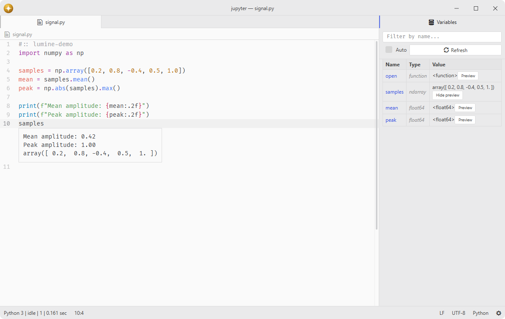

# jupyter-variables

Browse and edit a Jupyter kernel's namespace in a table.

Everything the kernel is holding, with its type and the best representation it can give — a dataframe's shape, an image's thumbnail, a Markdown `_repr_`. Names filter as you type, values can be edited in place, and any of them opens in jupyter-explorer.

## Features

- **The whole namespace**: every user-defined name, with its type and value.
- **Rich values**: renders the Markdown, HTML or image representation a kernel offers, falling back to its text.
- **Edit in place**: double-click a value, type a new one, and it is assigned in the kernel; leaving it untouched assigns nothing.
- **Filter by name**: a filter field narrows the table as you type.
- **Auto-refresh**: follow the kernel and re-read the namespace every time it falls idle, paused while the panel is closed.
- **Open in the grid**: a name opens in jupyter-explorer, when that package is installed.
- **Cached MCP access**: assistants can read a specific kernel's last namespace snapshot without refreshing it or executing code.



## Installation

To install `jupyter-variables` search for it in the Install pane of the Lumine settings, or run the command `lumine --install lumine-code/jupyter-variables`.

It reads its kernels from [`jupyter-repl`](https://github.com/lumine-code/jupyter-repl), which needs to be installed too.

## Commands

Commands available in `lumine-workspace`:

- `jupyter-variables:toggle`: open the panel, or close it when it is open,
- `jupyter-variables:toggle-focus`: focus the panel, or return focus to the editor when it already has it,
- `jupyter-variables:refresh`: re-read the namespace now.

## Usage

Only Python kernels are supported; the panel says so rather than showing an empty table for anything else.

Auto-refresh is off by default, and the setting decides what each new kernel starts with. It re-reads the namespace every time the kernel falls idle, which costs a round trip after every cell — worth it while you are working through a dataframe, wasteful during a long run. Closing the panel pauses it: nothing is re-read while there is nothing on screen to read it, and reopening picks up where it left off.

Refreshing shows lightweight summaries for up to 1,000 variables or 256 KiB. Use the name filter to find variables outside that snapshot. Open **Preview** on a row to compute its rich representation. Large dataframes and collections still show summaries, and image previews are limited to 256 KiB per representation. A fresh snapshot clears the current preview.

The walk leaves the namespace exactly as it found it: its own imports are local to it, and nothing it needs is added to or hidden from what you see.

## MCP tools

When `lumine-mcp` is connected, `ListJupyterVariables` lists the cached namespace and `GetJupyterVariable` reads a cached name. Both require an explicit `kernelId`, as returned by `ListJupyterKernels`; neither falls back to whichever editor is active. Reading never opens the panel, creates a store, evaluates a representation or sends a kernel request. A kernel whose namespace has not been refreshed reports `cache-unavailable` with an explanation.

`ListJupyterVariables` accepts `offset`, `limit` and `nameContains` independently of the panel's own filter. Both tools accept `maxChars` for each representation, defaulting to 1,000, and bound the JSON response to 32 KiB. The list contains namespace summaries. `GetJupyterVariable` can also read from the panel's filtered cache and include the current preview for its name. Images contribute their MIME types. `nextOffset` continues a list limited by pagination or the response budget. `namespaceTruncated` reports when the namespace snapshot was bounded.

Snapshots include an ISO `cachedAt`, the observed kernel execution count/time and conservative `stale` state. A known later execution, an active refresh, a busy kernel or a failed refresh marks the cache stale. `stale: false` means no known execution since the snapshot; it does not assert that the kernel was read live. Missing execution metadata leaves staleness unknown (`null`). Provider removal or kernel removal discards the associated cache; package deactivation withdraws the tools.

## Customization

Paste this into your `styles.css` to fit more names on screen:

```css
.jupyter-variables {
  .variable-table td {
    padding: 0.1em 0.3em;
  }
}
```

## Services

- `jupyter.kernel`: consumed to follow the active kernel and read its namespace.
- `jupyter.explorer`: consumed to open a name in jupyter-explorer.
- `jupyter.output`: consumed to colour and sanitize values with jupyter-repl's renderers; plain text without it.
- `mcp.tools`: provides `ListJupyterVariables` and `GetJupyterVariable` as bounded, read-only cache queries.

- `background-tips.provider`: provided to teach the package's headline action in an empty workspace.

## Contributing

Got ideas to make this package better, found a bug, or want to help add new features? Just drop your thoughts on GitHub. Any feedback is welcome!

Filter inputs retain their complete draft per kernel. Filters accept at most 4,096 UTF-16 units; larger drafts display an error and leave the last valid filter applied until shortened.
